# DEEN — Database Schema & Architecture

This document describes the PostgreSQL relational schema implemented for DEEN in Supabase. All private user data is strictly guarded with Row Level Security (RLS), while public religious content and verification logs are publicly readable.

---

## Architecture Principles

1. **Strict User Privacy**: All private records (prayers, qaza, reading history, journal, dhikr counts) are accessible ONLY by the authenticated owner (`auth.uid() = user_id`). No public leaderboards or religious scoreboards exist.
2. **Offline-First Resilience**: All private tables correspond 1:1 with client-side IndexedDB stores. Guest users have full functionality saved locally. Upon signing in, local data syncs smoothly with Supabase.
3. **Data Integrity**: UUID primary keys, foreign key constraints with `ON DELETE CASCADE`, check constraints for validity, and automated `updated_at` triggers.

---

## Schema Overview

### 1. User & Profile Management
- `profiles`: Extends Supabase `auth.users`. Contains display name, avatar, bio, preferred language, preferred theme.
- `user_preferences`: Stores locale (`ar`, `en`, `hi`, `gu`), audio reciter ID, Arabic font size, Arabic script style, auto-scroll preferences.
- `prayer_settings`: Stores latitude, longitude, city, calculation method, juristic method (Hanafi vs Shafi'i), minute adjustments for Fajr, Dhuhr, Asr, Maghrib, Isha, and notification preferences.

### 2. Worship & Habit Tracking
- `prayer_history`: Tracks individual prayer logs (Fajr, Dhuhr, Asr, Maghrib, Isha) with status (prayed, on_time, in_congregation), prayer date, and timestamp.
- `qaza_records`: Tracks missed prayers that the user needs to make up, including counts for Fajr, Dhuhr, Asr, Maghrib, Isha, and Witr.
- `fasting_records`: Tracks fasting days (Ramadan obligatory, voluntary, Sunnah Monday/Thursday, White Days, Qaza fasts) with status and reflections.
- `deen_daily_records`: Aggregates daily completion of 5 prayers, Quran reading, Dhikr goal, and fasting into a single daily record for analytics.

### 3. Quran Studies
- `quran_bookmarks`: Saved verses with Surah number, Ayah number, note, and tags.
- `quran_reading_history`: Recent reading positions (Surah, Ayah, timestamp) enabling seamless "Continue Reading".
- `quran_goals`: Target goals for completing the Quran (e.g., in Ramadan or 30/60/90 days), pages per day target, and current progress.

### 4. Dhikr & Tasbeeh
- `custom_dhikr`: User-defined custom adhkar (title, Arabic text, transliteration, target count).
- `tasbeeh_sessions`: Completed dhikr sessions with date, dhikr type, count achieved, and duration.

### 5. Supplications, Hadith & Names
- `dua_bookmarks`: Favorited supplications with custom user tags.
- `hadith_bookmarks`: Favorited Hadith with collection, Hadith number, and user reflection note.
- `favourite_names`: Favorited Divine Names of Allah (1–99).

### 6. Goals, Notes & Journal
- `personal_goals`: Private spiritual milestones (e.g. "Memorize Surah Al-Mulk", "Pray Tahajjud 3x weekly") with target dates and completion status.
- `reminders`: Scheduled spiritual alerts (e.g., Friday Surah Kahf reminder, daily morning adhkar, fasting on Mondays).
- `user_notes`: Private spiritual journal and reflections, encrypted at rest.

### 7. Religious Content Verification & Audit
- `content_sources`: Registry of canonical providers (Quran Foundation, Tanzil, AlAdhan, Sunnah.com, Hisn al-Muslim).
- `content_licences`: Legal terms and attribution requirements for each source.
- `content_verification_logs`: Audit trail recording verification runs, canonical hashes, and reviewer sign-offs.

---

## Entity-Relationship Diagram

```mermaid
erDiagram
    PROFILES ||--o{ PRAYER_SETTINGS : has
    PROFILES ||--o{ USER_PREFERENCES : has
    PROFILES ||--o{ PRAYER_HISTORY : logs
    PROFILES ||--o{ QAZA_RECORDS : tracks
    PROFILES ||--o{ QURAN_BOOKMARKS : saves
    PROFILES ||--o{ QURAN_READING_HISTORY : records
    PROFILES ||--o{ QURAN_GOALS : sets
    PROFILES ||--o{ TASBEEH_SESSIONS : saves
    PROFILES ||--o{ CUSTOM_DHIKR : creates
    PROFILES ||--o{ DUA_BOOKMARKS : favorites
    PROFILES ||--o{ HADITH_BOOKMARKS : favorites
    PROFILES ||--o{ FAVOURITE_NAMES : favorites
    PROFILES ||--o{ FASTING_RECORDS : logs
    PROFILES ||--o{ DEEN_DAILY_RECORDS : aggregates
    PROFILES ||--o{ PERSONAL_GOALS : manages
    PROFILES ||--o{ REMINDERS : configures
    PROFILES ||--o{ USER_NOTES : writes
```



---

## Row Level Security (RLS) Policy Blueprint

Every user-owned table enforces:
```sql
ALTER TABLE table_name ENABLE ROW LEVEL SECURITY;

CREATE POLICY "Users can manage their own records"
    ON table_name
    FOR ALL
    USING (auth.uid() = user_id)
    WITH CHECK (auth.uid() = user_id);
```
No user can query, insert, update, or delete any record belonging to another user.
