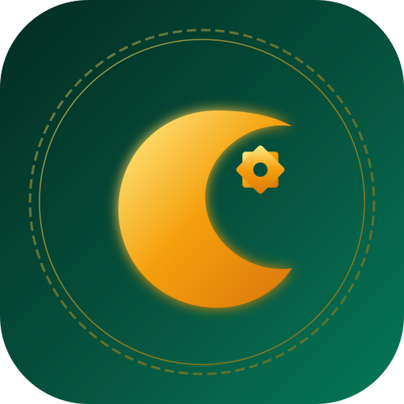

# DEEN — Every day, closer to Allah.

<p align="center">
  
</p>

<p align="center">
  <strong>Complete Multilingual Islamic Super App & Progressive Web Application (PWA)</strong><br>
  Built with React, TypeScript, Tailwind CSS, Supabase, and verified canonical Islamic data sources.
</p>

<p align="center">
  <a href="#features">Features</a> •
  <a href="#tech-stack">Tech Stack</a> •
  <a href="#quick-start">Quick Start</a> •
  <a href="#database--security">Database & Security</a> •
  <a href="#verified-sources">Verified Sources</a> •
  <a href="#license">License</a>
</p>

---

## Overview

**DEEN** is a modern, privacy-first, ad-free Islamic Super App designed to accompany Muslims worldwide across all facets of daily worship, Quranic study, spiritual reflection, and life milestones.

It is engineered with a mobile-first, installable Progressive Web App (PWA) architecture supporting offline worship, high-precision astronomical prayer calculation, verified Quranic texts in 4 languages (Arabic, English, Hindi, and Gujarati), canonical Hadith collections, and private spiritual habit tracking.

---

## Key Features

1. **Home Dashboard**: Gregorian & Hijri calendar, live prayer countdown, visual timetable, daily Ayah, daily Hadith, daily Dua, quick Dhikr, Ramadan countdown, and daily worship checklist.
2. **The Holy Quran**: All 114 Surahs and 30 Juz in authentic Uthmani script with Saheeh International (English), Maulana Azizul Haque (Hindi), Rabila Al-Umry (Gujarati), and transliteration. Verse-by-verse audio recitation from world-renowned reciters (Alafasy, Abdul Basit, Al-Husary, Minshawi), search, bookmarks, and night mode.
3. **Prayer Times & Adhan**: Exact timings (Fajr, Sunrise, Dhuhr, Asr, Maghrib, Isha) via GPS and manual city search. Dual calculation engine: AlAdhan API + offline astronomical math via Batoul Apps `adhan` library. Customizable calculation methods, Hanafi and Shafi'i Asr settings, minute offsets, prayer logging, and Qaza tracking.
4. **Interactive Qibla**: Real-time compass heading directly toward the Kaaba in Makkah using device orientation sensors and spherical trigonometry distance calculations.
5. **Digital Tasbeeh**: Pre-loaded authentic Sunnah Adhkar (SubhanAllah, Alhamdulillah, Allahu Akbar, Astaghfirullah, etc.) with tactile haptic feedback, custom dhikr creation, undo/reset, and session history.
6. **Duas & Adhkar (Hisn al-Muslim)**: 14+ categorized collections (Morning, Evening, Sleep, Food, Travel, Protection, Anxiety, Parents, Masnoon, Rabbana) with authentic citations, audio, and repetition counts.
7. **99 Names of Allah (Asma ul-Husna)**: Complete 99 Divine Names with Arabic calligraphy, transliteration, deep theological explanations, Quranic references, and audio pronunciation.
8. **Authentic Hadith Library**: Sahih al-Bukhari, Sahih Muslim, Sunan Abu Dawood, Jami' at-Tirmidhi, Sunan an-Nasa'i, Sunan Ibn Majah, and Riyad as-Salihin with in-book numbering and scholarly authenticity gradings.
9. **Islamic Calendar & Events**: Dual Hijri/Gregorian month views, Ramadan countdown, Eid al-Fitr, Eid al-Adha, Ashura, Arafah, and White Days fasting reminders.
10. **Stories of the Prophets (Qisas al-Anbiya)**: Detailed chronologies of all 25 Quranic Prophets grounded in Ibn Kathir's scholarship with explicit verse references and lessons.
11. **Islamic Learning**: Visual step-by-step interactive tutorials for Wudu, Ghusl, and Salah postures, alongside Taharah and Halal/Haram fundamentals.
12. **Hajj & Umrah Companion**: Complete interactive rites roadmap (Ihram, Tawaf, Sa'i, Mina, Arafat, Muzdalifah, Jamarat) with Talbiyah audio, Duas, checklists, and emergency hotlines.
13. **Zakat Calculator**: Multi-asset zakat computation across cash, gold, silver, investments, and business inventory with Gold/Silver Nisab toggles and printable breakdown reports.
14. **Personal Deen Tracker**: 100% private spiritual habit tracker (daily prayers, Quran reading, Dhikr, fasting, personal journal, and Recharts visual analytics). Zero public leaderboards.

---

## Tech Stack

- **Frontend**: React 18, TypeScript, Vite, Tailwind CSS, Framer Motion, Lucide React
- **PWA & Offline**: Vite PWA plugin, Service Workers, Cache API, IndexedDB (`idb`)
- **Backend & Database**: Supabase, PostgreSQL 15+, Supabase Auth, Row Level Security (RLS)
- **Calculation Engines**: Batoul Apps `adhan` astronomical engine, Great Circle Qibla algorithms
- **Hosting**: Vercel

---

## Quick Start

```bash
# Clone the repository
git clone https://github.com/BRAVE-lang/DEEN.git
cd DEEN

# Install dependencies
npm install

# Start local development server
npm run dev
```

Visit `http://localhost:5173`.

---

## Database & Security

All user records (worship history, bookmarks, qaza logs, notes) are strictly secured using PostgreSQL **Row Level Security (RLS)** in Supabase. Users can only access their own records (`auth.uid() = user_id`).

See [DATABASE_SCHEMA.md](./DATABASE_SCHEMA.md) and [supabase/migrations/](./supabase/migrations/) for full details.

---

## Verified Sources & Licensing

- Quran data: Quran Foundation (`api.quran.com`) & Tanzil Project
- Hadith: Sunnah.com & Darussalam verified collections
- Prayer timings: AlAdhan & Batoul Apps Adhan Engine
- Duas: *Hisn al-Muslim* by Shaykh Sa'id ibn Wahf al-Qahtani
- License: Apache License 2.0 (See [LICENSE](./LICENSE))

For complete documentation:
- [API_SOURCES.md](./API_SOURCES.md)
- [LICENSING_AND_ATTRIBUTION.md](./LICENSING_AND_ATTRIBUTION.md)
- [CONTENT_VERIFICATION.md](./CONTENT_VERIFICATION.md)
- [SETUP_GUIDE.md](./SETUP_GUIDE.md)
- [DEPLOYMENT_GUIDE.md](./DEPLOYMENT_GUIDE.md)
- [FEATURES_CHECKLIST.md](./FEATURES_CHECKLIST.md)
- [DEVELOPMENT_LOG.md](./DEVELOPMENT_LOG.md)
